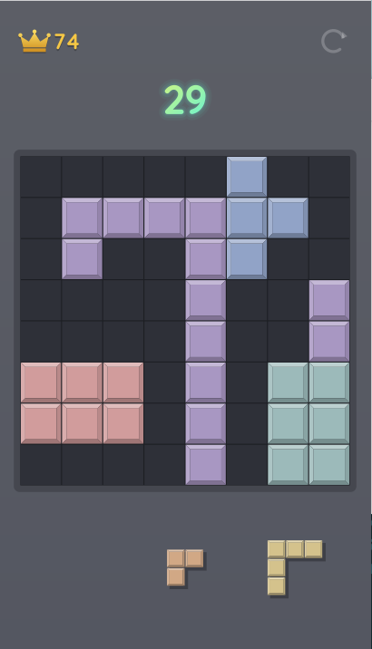

# BlockFall

Pardus için blok yerleştirme oyunu. Parçaları 8×8 tahtaya yerleştir, dolan satır ve sütunları temizle, kombolarla puanını katla. İnternet bağlantısı gerektirmez.



## Özellikler

- Sürükle-bırak ile parça yerleştirme, yerleşecek yerin ve temizlenecek satırların önizlemesi
- Kombo, çoklu satır ve tahtayı tamamen temizleme bonusları
- Yerleştirme, temizleme, parçacık ve yazı animasyonları
- En iyi skor kaydı (`~/.local/share/blockfall/save.json`)
- Kurulumda menü kaydı, simge ve masaüstü kısayolu

**Kısayollar:** F2 / Ctrl+N yeni oyun · Ctrl+Q çıkış

## Kurulum

[Releases](https://github.com/GokdenizGunay/BlockFall/releases) sayfasındaki ya da kendi derlediğin `.deb` dosyasına çift tıkla veya:

```bash
sudo apt install ./blockfall_<sürüm>_all.deb
```

Gerekenler (Pardus'ta hazır gelir): `python3`, `python3-gi`, `python3-gi-cairo`, `python3-cairo`, `gir1.2-gtk-3.0`.

Kaldırmak için: `sudo apt remove blockfall`

## Paketi derleme

Python 3 yeterlidir; `dpkg-deb` gerekmez, Windows'ta da çalışır:

```bash
python build_deb.py
```

Çıktı: `dist/blockfall_<sürüm>_all.deb`

## Proje yapısı

| Yol | İçerik |
|---|---|
| `src/blockfall.py` | Oyunun tamamı (GTK3 + Cairo) |
| `data/` | Masaüstü dosyası, simge, kurulum betikleri (`postinst`, `postrm`) |
| `build_deb.py` | `.deb` paketi üreticisi |

Doğrudan çalıştırmak için: `python3 src/blockfall.py`

## Lisans

Copyright © 2026 Gökdeniz G.

BlockFall özgür yazılımdır; [GNU Genel Kamu Lisansı sürüm 3](LICENSE) ya da (tercihinize bağlı olarak) daha sonraki bir sürümü (GPL-3.0-or-later) altında dağıtılır. Kodu kullanabilir, değiştirebilir ve dağıtabilirsiniz; değiştirilmiş sürümleri dağıtırken kaynak kodunu da aynı lisansla paylaşmanız gerekir. Program hiçbir garanti olmadan sunulmaktadır.
